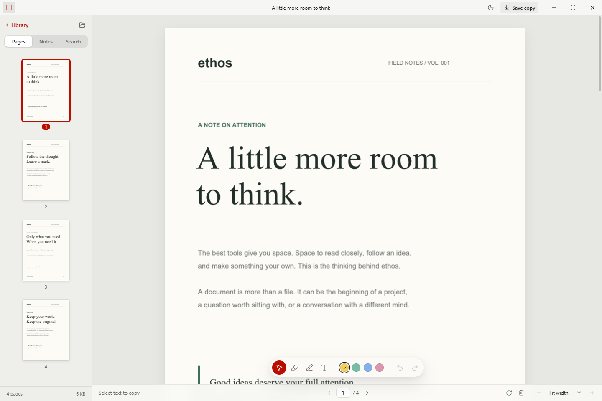

# ethos

A calm PDF reader for Windows, written in Rust, with the tools you reach for built in. Everything runs on your device.

ethos is a desktop PDF workspace. The native shell uses Tauri, the interface is Leptos compiled to WebAssembly, and PDFium renders pages.



## Tools

Press `Ctrl K`, or click the wrench, and start typing. Tools also appear where you need them, so there is no dashboard to learn. Every tool writes a new file and leaves your original alone.

| What you want | Where it lives |
| --- | --- |
| Export highlights and notes as Markdown | Notes tab, **Export** |
| Save as Markdown, plain text or Word | Tools list |
| Make a scan searchable | Offered on scanned pages, using the OCR built into Windows |
| Compare with another version | Tools list, then the sidebar lists each change |
| Combine PDFs | Tools list, or drop several PDFs on the window |
| Split a PDF, or save pages as a new PDF | Tools list |
| Save, rotate or delete several pages | Ctrl-click or Shift-click thumbnails |
| Reorder pages | Drag a thumbnail |
| Word to PDF, pictures to PDF, pages to pictures | Tools list |
| Fill in a form | Open it and type in the fields |
| Sign | `S`, then draw once and click to place. Drag to adjust |
| Redact | `R`, then drag over anything. It is removed when you save a copy |
| Make a smaller copy | Tools list |
| Add or remove a password | Tools list |

Signing draws your signature on the page. It is not a cryptographic digital signature.

Redacted pages are rebuilt as pictures, so nothing beneath them survives, and ethos checks the saved copy before it finishes. Other pages keep their selectable text. Your drawn signature and redaction areas stay on this device.

## Requirements

- Rust stable with the WebAssembly target: `rustup target add wasm32-unknown-unknown`
- [Trunk](https://trunkrs.dev) and the Tauri CLI: `cargo install --locked trunk tauri-cli`
- On Windows, either the MSVC build tools, or the `x86_64-pc-windows-gnu` toolchain with MinGW on `PATH`
- The WebView2 runtime, which ships with Windows 11

Ethos runs on 64-bit Windows only. The repository includes the Windows PDFium library, and file drops use a WebView2 API.

## Run locally

```sh
cargo tauri dev
```

## Use the reader

Open a PDF with **Open PDF**, drag it into the window, or use the built-in sample. Use the sidebar for page navigation, annotations, and text search. The floating toolbar provides text selection, highlighting, drawing, and text notes. Annotations and page rotation or deletion support undo and redo.

Open and Save copy use your operating system's native file dialogs, including its folder shortcuts and overwrite confirmation.

Your marks and page changes save automatically, so you can close a document and find them there when you reopen it. Ethos never changes the original PDF: edits live in `%APPDATA%\\ethos\\marks`, matched to the file by its contents, so they follow a renamed or moved file. Protected documents and the sample are the exception. Their edits stay in memory, and ethos asks before discarding them.

**Save copy** writes your changes into a separate PDF as standard annotations, which other PDF apps can show and edit. Reopen that copy in ethos and your marks are editable again.

Recent document paths are stored in `recent.json` in `%APPDATA%\ethos`, and your appearance preference is stored in the WebView2 profile. The first launch after an Electron release adopts its saved appearance. Recent PDFs are not duplicated into an app library.

This version supports a single active PDF, files up to 200 MB, and up to 2,000 pages. Protected documents can be read with their password; exporting them is not supported. New text notes use Helvetica and support Western European characters.

## Verify

```sh
cargo test -p ethos-core -p ethos-engine -p create-icon
cargo test -p ethos --bin ethos
cargo clippy --workspace --all-targets
cd ui && trunk build --release && cd ..
cargo test -p ethos --features e2e --test e2e
```

To check Word to PDF against files written by real Word, point this at a folder of `.docx` or `.dotx` files:

```sh
cargo run -p ethos-engine --example word_round_trip -- <input folder> <output folder>
```

The end-to-end test launches the real app and drives it through WebView2's DevTools protocol. It uses a temporary profile and generated PDFs, and scripts the native file dialogs. It does not touch your normal app profile. Screenshots land in `target/tmp/e2e/`.

## Build a Windows installer

```sh
cargo tauri build
```

The installer is written to `target/release/bundle/nsis/`. Code signing and automatic updates are not configured.

## Layout

| Path | Contents |
| --- | --- |
| `core/` | Types and logic shared by the interface and the engine: geometry, note wrapping, search matching |
| `engine/` | PDF parsing, rendering and text extraction with PDFium; export and the sample PDF with lopdf |
| `src-tauri/` | The desktop shell: windows, file dialogs, bounded file access, the recent list |
| `ui/` | The Leptos interface and its CSS |
| `tools/create-icon/` | Generates the app icons from the approved artwork |

## License

Ethos is available under the [MIT License](LICENSE). Third-party software keeps its own licenses. See [THIRD_PARTY_NOTICES.md](THIRD_PARTY_NOTICES.md).

## Current scope

Editing a PDF's existing text or images, cryptographic signatures, and printing are not implemented. Word to PDF lays out text, styles, lists, tables and inline pictures with fonts installed on Windows. It does not reproduce headers, footers or the exact position of floating shapes, and text box contents flow after the paragraph they belong to.
